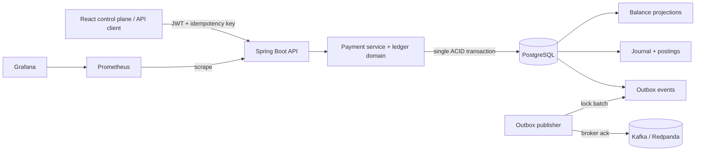

# ClearLedger

**A full stack portfolio application for account transfers and double-entry journals.**

ClearLedger accepts idempotent account transfers, locks balances safely, writes balanced immutable journal entries, and publishes payment events through a transactional outbox. A React operations console exposes the same API used by integrations. The repository includes observability, container orchestration, security boundaries, database migrations, architecture tests, and CI.

## What makes it technically interesting

- **Money is stored in minor units** (`long`/`BIGINT`), avoiding floating-point errors.
- **Double-entry invariants exist twice:** in the Java aggregate and in a PostgreSQL trigger that checks postings before the journal changes to POSTED.
- **Concurrent payments use deterministic pessimistic row locking** plus optimistic version columns, preventing overspend and lock-order deadlocks.
- **Idempotency is tenant-scoped.** Identical concurrent retries return the original payment; changing its accounts, amount, currency or reference returns a conflict. The original journal description is retained on replay.
- **Payment, balance projection, journal and outbox event commit atomically** in one database transaction.
- **Kafka publishing is at-least-once.** The outbox worker marks events only after broker acknowledgement, so consumers must deduplicate by event ID.
- **Verified tenant identity:** issuer, expiry, API audience and `tenant_id` are validated. Tenant headers cannot select another organisation, and pending-event counts are tenant-scoped.
- **Working React workflows:** real payment creation, stable retry keys, record search, journal CSV export, loading/error/empty states and read-only controls.
- **Architecture rules are executable.** ArchUnit stops domain packages from depending on HTTP adapters.

## Stack

| Layer | Technology | Responsibility |
|---|---|---|
| Web | React 19, TypeScript, Vite, TanStack Query, React Router | Typed operations console, caching and mutation state |
| API | Java 21, Spring Boot 4, Spring MVC, Bean Validation | Versioned REST boundary and RFC-style errors |
| Security | Spring Security, OAuth2 Resource Server, JWT scopes | Stateless API authentication and write/read authorization |
| Data | PostgreSQL 17, Spring Data JPA, Flyway | ACID ledger, migrations, locks and database constraints |
| Messaging | Kafka-compatible Redpanda, transactional outbox | Reliable payment lifecycle events |
| Operations | Actuator, Micrometer, OpenTelemetry bridge, Prometheus, Grafana | Health, metrics and trace correlation |
| Delivery | Docker, Compose, Nginx, GitHub Actions | Reproducible runtime and gated builds |
| Quality | JUnit 5, Mockito, AssertJ, Testcontainers, ArchUnit, Oxlint | Unit, boundary, database and architecture verification |

## Architecture



The repository is a modular monolith by design. The ledger and payment consistency boundary stays inside one transaction while package boundaries preserve a future extraction path. See [the detailed architecture](docs/architecture.md) and [ADR-001](docs/adr/001-ledger-consistency.md).

## Run the entire platform

Prerequisite: Docker Desktop with Compose.

For setup verification, local security boundaries and troubleshooting, see the [local development runbook](docs/local-development.md).

```bash
cp .env.example .env
docker compose up --build
```

The default stack runs the database, identity provider, broker, API and UI. Broker inspection and monitoring are optional:

```bash
docker compose --profile tools up --build
```

| Service | URL |
|---|---|
| Operations console | http://localhost:3000 |
| Swagger UI | http://localhost:8080/docs |
| API health | http://localhost:8080/actuator/health |
| Redpanda Console (`tools` profile) | http://localhost:8090 |
| Prometheus (`tools` profile) | http://localhost:9090 |
| Grafana (`tools` profile) | http://localhost:3001 (admin / value from `.env`) |

Compose includes a local Keycloak realm and uses the authenticated API in every profile. At http://localhost:3000, sign in as **operator** or **reader** with the local-only password `Local-demo-only-2026!`. The `other-tenant` account demonstrates an empty organisation without Northstar access. See [authentication](docs/authentication.md) for PKCE, token refresh, tenant claims and production configuration.

### Frontend-only portfolio demo

The UI has an explicit in-memory adapter—never a silent fallback—to make the portfolio experience available without infrastructure:

```bash
cd apps/control-plane
npm ci
VITE_DEMO_MODE=true npm run dev
```

On PowerShell: `$env:VITE_DEMO_MODE='true'; npm run dev`.

## API example

```bash
curl -X POST http://localhost:8080/api/v1/payments \
  -H 'Content-Type: application/json' \
  -H 'Authorization: Bearer YOUR_ACCESS_TOKEN' \
  -H 'Idempotency-Key: order-88422' \
  -d '{
    "merchantReference":"ORD-88422",
    "sourceAccountId":"11111111-1111-1111-1111-111111111111",
    "destinationAccountId":"33333333-3333-3333-3333-333333333333",
    "amountMinor":125000,
    "currency":"GBP",
    "description":"Merchant settlement"
  }'
```

Submitting the identical request with the same key is safe, including simultaneous retries. Reusing the key with different transfer fields or reusing a merchant reference returns `409 Conflict`. Keys must contain 1–128 characters and cannot be blank.

## The payment transaction

1. Validate the command and look up any prior idempotent result.
2. Lock both accounts in stable UUID order.
   Recheck the idempotency key after waiting for the locks, before changing either balance.
3. Verify tenant, status, currency and available funds.
4. Apply debit and credit balance projections.
5. Create two equal and opposite postings.
6. Post the journal, causing PostgreSQL to re-check balance.
7. Persist a versioned payment intent and outbox event.
8. Commit all state together—or roll all of it back.
9. Publish the outbox record to `payments.lifecycle.v1` and mark it published after acknowledgement.

## Verification

```bash
# Backend: unit + service + ArchUnit; PostgreSQL integration uses Docker or an explicit test database
cd services/ledger-api
./mvnw verify

# Frontend: static analysis + strict TypeScript + production bundle
cd apps/control-plane
npm ci
npm run lint
npm test
npm run build
```

CI repeats both pipelines, validates the Compose model, and builds production images. Testcontainers runs the real PostgreSQL migrations and exercises sequential and simultaneous replays, conflicting keys/references and competing spends. Without Docker, a dedicated local PostgreSQL database can be supplied as described in the [runbook](docs/local-development.md#tests-and-diagnosis).

## Repository map

```text
apps/control-plane/           React/TypeScript operations console
services/ledger-api/         Spring Boot application and tests
  src/main/.../account       Balance aggregate and locking repository
  src/main/.../ledger        Journal and posting invariants
  src/main/.../payment       Transactional payment use case
  src/main/.../outbox        At-least-once Kafka publisher
  src/main/resources/db      Versioned Flyway migrations
infra/                       Prometheus and Grafana provisioning
docs/adr/                    Architecture decisions and trade-offs
.github/workflows/ci.yml     Build, test and image pipeline
compose.yml                  Complete local platform
```

## Interview discussion prompts

- Why use a modular monolith instead of independent ledger and payment services?
- Why is an outbox safer than writing to PostgreSQL and Kafka independently?
- Where does exactly-once stop, and why must consumers remain idempotent?
- Why combine pessimistic locks with an optimistic version column?
- How would a reconciliation job prove projections match the journal?
- How are issuer, audience, permissions and tenant identity validated independently?

## Deliberate next steps

The outbox currently uses one polling publisher and marks an event FAILED after ten failed attempts. Multi-publisher row claims and failed-event replay are not implemented.

This repository keeps the core complete and the roadmap honest. Production evolution would add a consumer-side inbox, automated journal-to-projection reconciliation, OIDC realm provisioning, rate limiting, and Kubernetes/Helm deployment. These are documented boundaries, not features claimed by the UI.

MIT licensed. See [the threat model](docs/threat-model.md) before using the design beyond a portfolio or learning environment.
